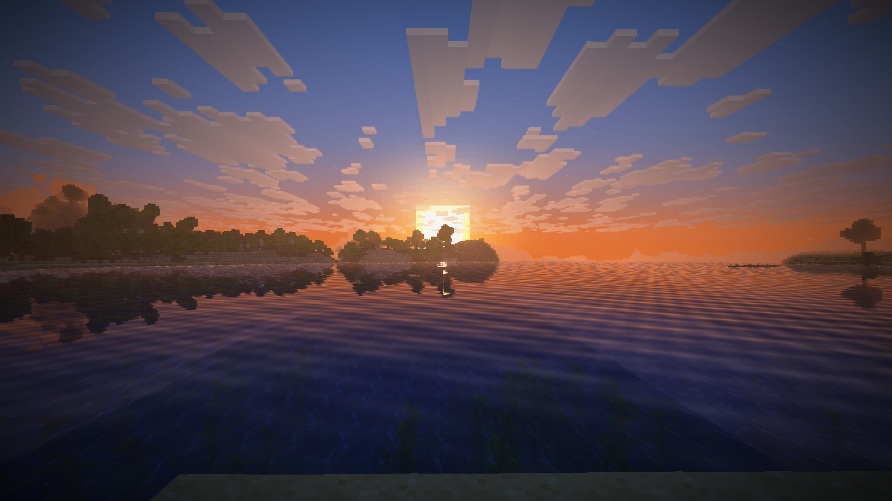
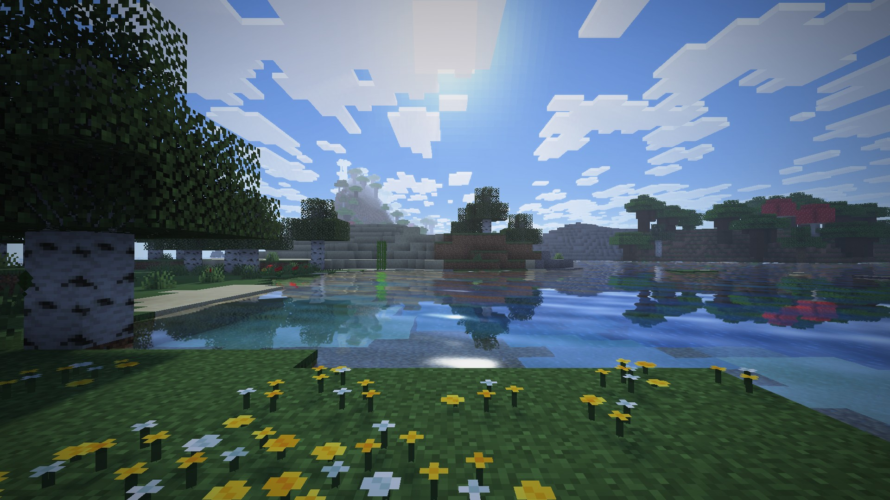
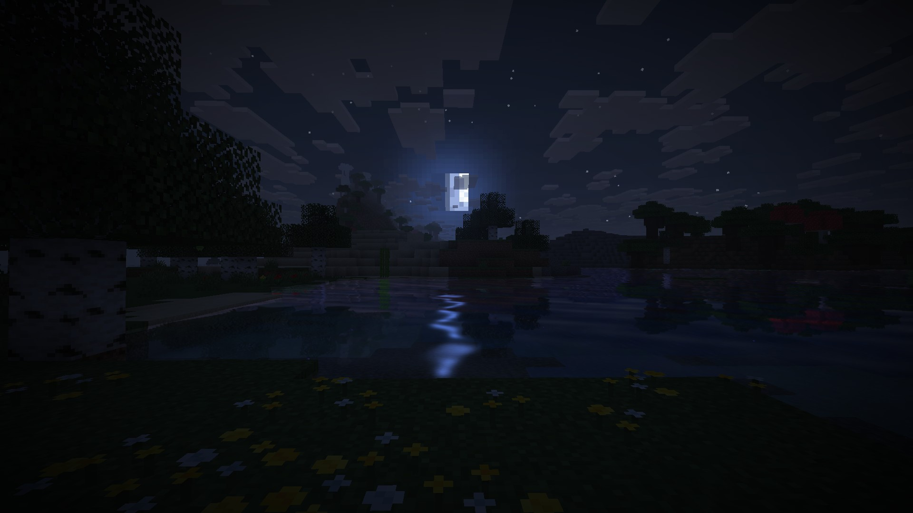

# Daybreak: a shader pack for Horizon

**Daybreak** is a shader pack for [Horizon](https://github.com/horizon-rust/horizon), the Rust
reimplementation of Minecraft: Java Edition. It's written in WGSL against Horizon's own shader
API (0.1). It runs inside Horizon's renderer and doesn't replace it, so Horizon's culling,
batching, LOD and meshing stay in charge, and the pack adds as little GPU time as possible.



<p>
  
  
</p>

On an RTX 4070 SUPER at 1920 × 1080 these scenes cost the pack 1.2–1.4 ms of GPU time per frame,
shadow pass included (F3: [day](docs/screenshots/f3-day.jpg), [night](docs/screenshots/f3-night.jpg),
[sunset](docs/screenshots/f3-sunset.jpg)).

| Effect | How | Cost |
| --- | --- | --- |
| Sun and moon shadows | 2048² distorted shadow map, normal-offset lookup, slope-scaled bias, 1/4/9-tap grid PCF (smooth edges, no noise) | the shadow pass plus up to 9 compare taps per pixel |
| Day and night light | own sun, sky and block light, wrapped diffuse, with vanilla's face shade taken back out | inside terrain's own draw: no extra pass |
| Coloured block light | soul fire blue, redstone red, copper green, froglights… (`[[lights]]`) | one 3D texture read |
| Mob shadows | mobs, chests and particles take the sun's shadow and the sky's tint in the composite, by a terrain mask (`set_surface`) and the same shadow map | 4 compare taps, only on non-terrain pixels |
| Light from held torches | Horizon's dynamic lights, in the item's colour, per pixel | Horizon's own: none from the pack |
| Waving leaves and plants | vertex stage, continuous across two-block plants | a few `sin`s per vertex |
| Water | rolling waves, Fresnel reflection (water mirror), refraction, depth absorption, sun glint | half-resolution mirror, can be turned off |
| Sky | deeper zenith, warm sunset band, sun glow; vanilla's horizon kept, so fog never seams | per sky pixel |
| Sun rays | screen-space radial march over the sky mask, **quarter resolution**, 16 dithered steps | ~1/16 of the pixels |
| Sun glare | bloom, halo, anamorphic streak and lens ghosts, dimmed by how much of the sun shows (9 taps) | in the same quarter-resolution pass |
| Haze | aerial perspective from depth: distant land fades to the sky, warm toward the sun | part of the composite |
| Bloom | Karis-averaged bright pass and a 13-tap two-ring blur, both **quarter resolution** | ~1/16 of the pixels |
| Grade | eye adaptation from the light at the camera, shoulder, S-curve, saturation, vignette, dither | one full-screen pass |

Every option is a WGSL `override` constant, so a switched-off effect is a branch on a constant:
the GPU never runs it, and nothing is recompiled with text substitution.

## Quality

The most expensive part is the shadow pass, which draws the terrain in its square again each
frame. Its size is up to the player: **Shadows** off means no shadow map and no pass at all,
**Shadow detail** is the map's size and **Shadow distance** the square it covers (Lighting page of
the Shader Options). Changing them rebuilds the map; nothing else is reloaded. The defaults are
High; for slower or faster GPUs:

| Level | Shadows | Shadow detail | Shadow distance | Shadow edges | Reflections | Sun rays |
| --- | --- | --- | --- | --- | --- | --- |
| Low (about 0.5 ms) | off | – | – | – | off | 0 |
| Medium (about 1 ms) | on | 1024 | 64 | Sharp | off | 0.35 |
| **High** (default, about 1.2–1.4 ms) | on | 2048 | 96 | Soft | on | 0.5 |
| Ultra | on | 4096 | 160 | Very soft | on | 0.6 |

Until 0.1.1 these were four separate packs (Daybreak Low, Medium and Ultra came in a zip),
because a pack's shadow map was fixed by its manifest. Horizon's shader API now lets options
size it ([horizon#8557](https://github.com/horizon-rust/horizon/pull/8557)), so one pack does
all four. Old `daybreak_low`, `daybreak_medium` and `daybreak_ultra` packs can be deleted from
`shaderpacks/`.

## Try it

1. Install the Horizon launcher and a Nightly from 2026-11-05 or newer (Daybreak 0.2 needs
   Horizon's `[shadow]` options; 0.1.1 runs on Nightlies from 2026-11-03).
2. Install Daybreak from the launcher's mod browser (Shader packs), or put
   `daybreak-<version>.hshader` from a [release](https://github.com/hildlabs/horizon-shaders/releases)
   into `shaderpacks/` beside your `options.txt`.
   For working on the shaders, link the source pack instead (it hot-reloads every save):
   ```powershell
   powershell -ExecutionPolicy Bypass -File tools\link-pack.ps1
   ```
3. In the game: **Options > Horizon Settings > Shader Packs > Daybreak (Horizon)**, then
   **Shader Options…** for the settings and the quality (Lighting page).
4. For light from torches in your hand and dropped on the ground, turn on Horizon's
   **Dynamic lights** in the game's Horizon settings (it is off by default).
5. Press **F3** to see each pass's GPU time.

## Develop

```sh
cargo install --git https://github.com/horizon-rust/horizon --rev ee06d18c391102428fa5dded4f3d9d091ea361f0 horizon-shader-api --locked
horizon-shader check pack/daybreak    # what the game, the launcher and the registry check
horizon-shader pack pack/daybreak     # writes daybreak-<version>.hshader
```

| File | Stage |
| --- | --- |
| `common.wgsl` | shared: material ids, the light's colour, noise, the tone shoulder, the water wave |
| `vertex.wgsl` | wind on leaves and plants, waves on water |
| `material.wgsl`, `lighting.wgsl`, `water.wgsl` | how terrain and water are lit |
| `sky.wgsl` | the sky's colour |
| `post/*.wgsl` | bloom prefilter → bloom blur → sun rays → composite |

The API reference is Horizon's
[`docs/api/shaders-reference.md`](https://github.com/horizon-rust/horizon/blob/main/docs/api/shaders-reference.md).

## Credits

Original code, MIT licensed. The techniques come from published work: interleaved gradient noise
and the Karis average (Jimenez, *Next Generation Post Processing in Call of Duty: Advanced Warfare*,
2014), Schlick's Fresnel approximation (1994), Vogel-spiral disc sampling. No code from other
shader packs and no Minecraft assets are included.
